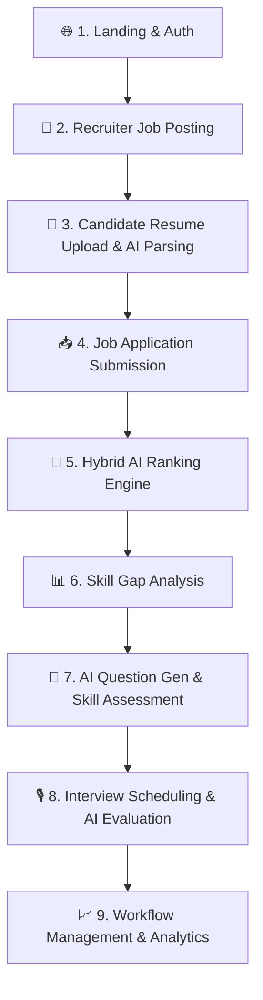

# SmartRecruit - Generative AI–Powered Recruitment Intelligence Platform

SmartRecruit is an enterprise-grade, Generative AI–powered Recruitment Intelligence Platform built on Django 5.x and MySQL 8.0. It automates end-to-end recruitment workflows—including resume parsing, job match analytics, dynamic AI-driven interview question generation & candidate evaluation (powered by Groq / LLaMA 3), interactive coding assessments, real-time candidate ranking, and skill gap analyses.

---

## 🌟 Key Features & Capabilities

### 🔐 Multi-Role Authentication & Access Control (RBAC)
- **Role-Based Workflows**: Custom user models supporting **Candidates**, **Recruiters / Hiring Managers**, and **Platform Administrators**.
- **Secure Authentication**: Built-in Django authentication with custom registration, profile onboarding, and session management.

### 💼 Recruiter & Hiring Manager Dashboard
- **Job Lifecycle Management**: Post, manage, and toggle status (Active/Closed) for job openings with structured requirements, key skills, and experience criteria.
- **Application Tracking System (ATS)**: Manage candidate applications across multiple stages (`Applied`, `Screened`, `Interviewing`, `Assessment`, `Hired`, `Rejected`).
- **AI Match Scoring**: Automatic calculation of applicant suitability scores based on resume parsing and job description match.
- **Analytics & Exporting**: Visual analytics powered by **Chart.js** with reporting capabilities in **PDF** (via `xhtml2pdf`), **Excel** (via `openpyxl`), and **CSV**.

### 📄 Candidate Portal & AI Resume Intelligence
- **Resume Upload & Parsing**: Supports PDF (`PyMuPDF` / `fitz`) and Word (`python-docx`) formats. Extract key details, technical skills, and experience automatically using SpaCy NLP & Regex engines.
- **Job Search & One-Click Application**: Candidates can explore active listings, filter by skills or title, and submit tailored applications with custom cover letters.
- **Skill Gap Analysis**: Automated feedback engine identifying missing domain skills required for targeted job roles.

### 🤖 AI-Powered Interview & Assessment Engine (Groq LLaMA 3)
- **Dynamic Question Generation**: Leverages the **Groq AI SDK** (`llama3-70b-8192` / `llama3-8b-8192`) with **Pydantic** structured schema validation and **Tenacity** retry mechanics to generate tailored technical, behavioral, and situational questions.
- **Interactive Coding & Skill Assessments**: Real-time timed assessment engine for evaluating candidates with structured scoring.
- **Automated Interview Evaluation & Transcripts**: Evaluates candidate responses against job standards, producing structured qualitative feedback, score cards, and hiring recommendations.
- **Interactive AI Recruiter Assistant**: Context-aware AI chat assistant (`/assistant/`) providing real-time recruiting insights and talent analysis.

### 🔔 System Utilities & Infrastructure
- **Real-Time Notification Hub**: Dynamic notifications for application status updates, interview schedules, and assessment feedback.
- **Media & Document Storage**: Isolated secure media storage for resumes, candidate avatars, and generated reports.

---

## 🏗️ Architecture & Technology Stack

| Layer | Technology / Libraries |
| :--- | :--- |
| **Backend Framework** | Django 5.0.3, Django REST Framework |
| **Database** | MySQL 8.0 (via `mysqlclient`) |
| **Generative AI Engine** | Groq SDK (`groq`), Pydantic 2.x, Tenacity |
| **NLP & Document Parsing**| SpaCy (`en_core_web_sm`), PyMuPDF (`fitz`), `python-docx` |
| **Analytics & Data Science**| Sentence-Transformers, OpenPyXL, Chart.js |
| **Document Generation** | xhtml2pdf (PDF reports), OpenPyXL (Excel export) |
| **Frontend Styling** | Vanilla CSS (Glassmorphism design system), Bootstrap 5 |

---

## 📁 Repository Structure

```
SmartRecruit/
├── accounts/          # User authentication, custom User model, profiles, RBAC
├── applications/      # Job application processing, status tracking & match scoring
├── assessments/       # Interactive candidate coding/skill assessment module
├── assistant/         # Groq AI-powered recruiter assistant chatbot
├── candidates/        # Candidate profiles, resume management, parsing engine
├── companies/         # Recruiter profiles & company management
├── dashboard/         # Analytics overview, metrics visualizer & export tools
├── interviews/        # AI question generator & candidate interview evaluations
├── jobs/              # Job posting, requirement management, listing feeds
├── ranking/           # Real-time candidate ranking algorithm & leaderboard
├── skill_gap/         # Skill gap comparison engine & candidate feedback
├── smartrecruit/       # Django core settings, URL routing, context processors
├── templates/         # UI layout templates & Glassmorphism view components
├── static/            # Static assets (CSS, JS, images)
├── media/             # Media storage for uploads (Resumes, Avatars)
├── docker-compose.yml # MySQL 8.0 & Web service orchestration
├── Dockerfile         # Python environment build specs
└── manage.py          # Django CLI management script
```

---

## 🔄 End-to-End Project Flow & System Lifecycle

SmartRecruit orchestrates a complete 9-phase recruitment pipeline connecting candidates, recruiters, and administrators:



### Phase-by-Phase Lifecycle

1. **User Registration & Onboarding (`/accounts/register/`)**
   - Multi-role self-registration supporting **Candidate** and **Recruiter / Hiring Manager** roles.
   - Server-side role guard enforcing valid choices and custom user creation.
   - Automated routing to role-specific dashboards (`/dashboard/`).

2. **Job Setup & Management (`/jobs/`)**
   - Recruiters specify key requirements, job descriptions, skill tags, employment types, and salary brackets.

3. **Candidate Resume Intelligence (`/candidates/`)**
   - Candidates upload resumes (PDF / DOCX).
   - SpaCy NLP & PyMuPDF extract skills, work history, education, projects, and certifications into structured profile data.

4. **Application Submission (`/applications/`)**
   - Candidates search jobs and apply with customized cover letters.
   - Applications start at state `APPLIED`.

5. **Hybrid AI Ranking Engine (`/ranking/`)**
   - **Layer 1 (Semantic Scoring)**: `sentence-transformers` evaluates similarity across 5 weighted dimensions (Skill Match 40%, Experience 20%, Education 15%, Projects 15%, Certifications 10%).
   - **Layer 2 (LLM Validation)**: Groq (LLaMA 3) synthesizes qualitative summaries, candidate strengths, potential risks, and hiring verdicts (`SUITABLE`, `MAYBE`, `REJECT`).

6. **Skill Gap Analysis (`/skill-gap/`)**
   - Automated gap reports comparing applicant skills against job standards, providing personalized learning paths and recommended certifications.

7. **Interactive Assessment Engine (`/assessments/`)**
   - Real-time technical skill tests and coding assessments with automated score reporting.

8. **AI Interview Pipeline (`/interviews/`)**
   - Dynamic AI question set generation customized to the specific candidate and role.
   - Interview scheduling with calendar links.
   - Transcript parsing and automated scoring of technical competency, communication, and confidence.

9. **ATS Workflow & Analytics (`/dashboard/`)**
   - Recruiters transition applicants across 8 stages (`Applied`, `Screened`, `Shortlisted`, `Assessment`, `Interview`, `HR Round`, `Offer`, `Rejected`).
   - Executive dashboards visualize hiring pipelines and generate downloadable PDF/Excel audit reports.

---

### Option 1: Native Local Setup (Windows / Linux / macOS)

#### Prerequisites
- **Python 3.10+**
- **MySQL 8.0 Server** (running locally on port 3306)
- **C/C++ Build Tools** (for compiling `mysqlclient` if required)

#### 1. Clone & Setup Virtual Environment
```bash
git clone https://github.com/your-username/smartrecruit.git
cd smartrecruit

python -m venv venv
# On Windows (PowerShell):
.\venv\Scripts\Activate.ps1
# On Linux/macOS:
source venv/bin/activate
```

#### 2. Install Dependencies & SpaCy Model
```bash
pip install -r requirements.txt
python -m spacy download en_core_web_sm
```

#### 3. Environment Configuration
Create a `.env` file in the project root directory (or copy `.env.example`):
```bash
cp .env.example .env
```
Ensure your `.env` contains valid database credentials and your Groq API key:
```ini
SECRET_KEY=your-django-secret-key
DEBUG=True
ALLOWED_HOSTS=127.0.0.1,localhost

DB_NAME=smartrecruit
DB_USER=root
DB_PASSWORD=root
DB_HOST=localhost
DB_PORT=3306

GROQ_API_KEY=gsk_your_groq_api_key_here
```

#### 4. Database Setup & Migrations
Create the `smartrecruit` database in MySQL:
```sql
CREATE DATABASE smartrecruit CHARACTER SET utf8mb4 COLLATE utf8mb4_unicode_ci;
```

Run Django migrations:
```bash
python manage.py migrate
python manage.py createsuperuser
```

#### 5. Launch Development Server
```bash
python manage.py runserver
```
Visit `http://127.0.0.1:8000` in your web browser.

---

### Option 2: Docker Setup (Containerized MySQL & App)

#### Prerequisites
- **Docker Desktop** installed and running.

#### 1. Build and Start Services
```bash
docker-compose up --build -d
```

#### 2. Run Database Migrations Inside Container
```bash
docker-compose exec web python manage.py migrate
docker-compose exec web python manage.py createsuperuser
```

#### 3. Access Application
Open `http://localhost:8000` in your browser.

---

## 🧪 Testing & Code Quality

Run the automated Django test suite:
```bash
python manage.py test
```

To run tests for specific modules (e.g., jobs, applications, or interviews):
```bash
python manage.py test applications jobs interviews
```

---

## 📄 License & Attribution

This project is licensed under the **MIT License**.
SmartRecruit is built with Django, MySQL, Groq AI, SpaCy, and Bootstrap.
